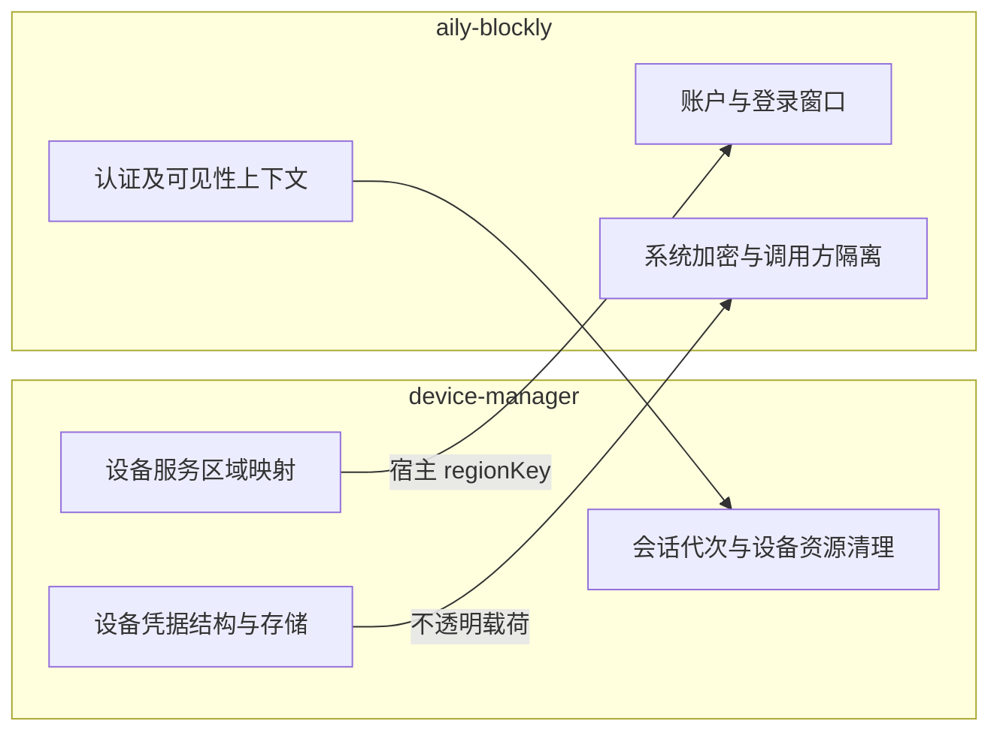
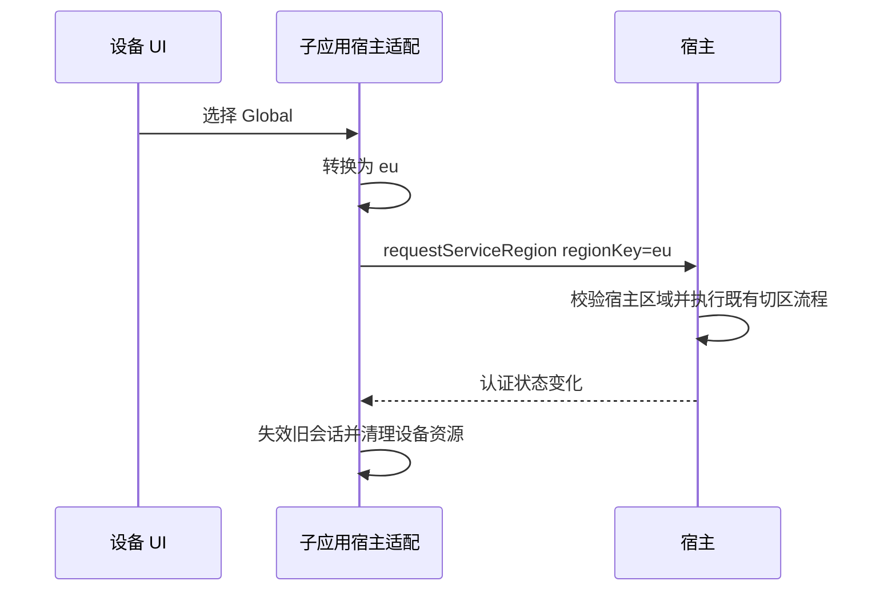

# 设备管理宿主边界修正记录

## I — Intent：最终目标

响应用户对宿主职责边界的纠正：设备服务的区域映射、设备凭据格式、连接释放和页面关闭决策应由 device-manager 实现。宿主只提供其真正拥有的账户、系统加密和窗口上下文能力。

本次审查覆盖本轮迁移对 aily-blockly 的全部工作区改动，并同步修正 device-manager 调用方。没有扩大到其他既有 subapp 的业务重构。

## D — Data：发现与修正

| 原改动 | 问题 | 修正结果 |
| --- | --- | --- |
| `auth/policies/device-manager-region.ts` | 将设备服务 China/Global 与宿主 cn/eu 的转换放进宿主 | 删除此文件；映射回到 device-manager 的 HostService.selectRegion |
| `requestDeviceServiceRegion({region})` | 宿主接口接收设备域概念，形成专有业务入口 | 改为 `requestServiceRegion({regionKey})`；宿主仅校验自己的有效区域并执行既有切区流程 |
| 专有 `device-manager-storage-bridge.js` | 宿主理解设备账户 context、key、value 结构 | 删除；改为通用 subapp-safe-storage 桥，只加解密不透明载荷；实际调用方身份隔离仍由宿主执行 |
| 宿主凭据 envelope 校验 | 设备数据 schema 与账户范围应属于子应用 | context/key/value 包装与验证移到 device-manager runtime/storage.js |
| `auth-required-tool.ts` 额外收集 device-manager | 将子应用的会话资源清理绑到宿主专门关闭工具的策略 | 撤销；恢复原文件。子应用响应认证快照变化、请求前校验会话并释放资源 |
| `stopDefaultAilyChatRuntime()` 同时停止 device-manager | Chat 专用方法夹带另一业务工具 | 撤销；恢复原方法语义 |
| 宿主切区时专门重启 device-manager | 重启被用来代替子应用处理会话和区域失效 | 撤销；保留子应用侧会话代次、API 取消及连接清理 |
| beforeClose 失败时特殊阻止关闭 device-manager | 在通用宿主代码中增加设备工具特判 | 撤销；使用既有 beforeClose / waitForCloseDecision，确认逻辑由子应用持有 |
| 整文件空行变化 | 与实际功能无关，放大审阅成本 | 恢复未改动代码的原有格式，仅保留相关语义修改 |

### 仍需保留在宿主的部分

| 能力 | 留在宿主的原因 |
| --- | --- |
| host-auth 进程桥允许 device-manager 取 access token / 请求刷新 | 子应用不能自行授予自己读取宿主账户凭据的权限；真实进程身份由宿主管理 |
| 账户租约的可选 accountId | 身份来自宿主账户；供子应用离线缓存确定账户范围，不承载 IoT 用户资料或设备字段 |
| 登录窗口入口与无 token 认证状态 | 登录窗口、主账户状态属于宿主；不把 refresh token 下发子应用 |
| 独立窗口使用宿主认证快照 | 独立窗口中的宿主 Angular AuthService 在 iframe 启动前运行；子应用无法阻止它产生第二个刷新者 |
| Electron safeStorage 调用与 subapp 身份隔离 | Node 子进程没有 Electron 主进程的系统保护存储接口；宿主不解析其中的设备数据 |
| `active` 上下文 | iframe 自身无法可靠识别宿主使用 CSS 隐藏工具的状态；宿主通知可见性，子应用决定暂停哪些资源 |
| 接收宿主 `regionKey` 的切区入口 | 切换宿主账户认证域、清理宿主会话和打开登录均为宿主职责；区域映射已在调用方完成 |

现有主窗口消息的切区处理复用同一 `switchHostServiceRegion` 方法，避免为子应用复制一套切区步骤。没有新增通用插件框架或按设备种类分派的宿主服务。

## E — Edges：边界与限制

- 宿主中出现 device-manager ID 的剩余位置用于调用资格或独立窗口身份识别，不包含设备协议、IoT API、凭据 key 或区域转换。
- 子应用关闭不等于宿主账号退出；设备工具未获得进程桥的全局 logout 操作。
- 取消了宿主对设备 runtime 的专门重启/停止后，子应用必须自行响应认证变化。其 runtime 在受保护操作前校验宿主会话，切换账户后取消 API、串行释放配网及 BLE 资源。
- 本次未新增测试用例，未运行浏览器或真实设备确认；设备包已完成生产构建、便携启动与隔离开发链接，但真实宿主 SSO、硬件和视觉仍未验证。

## A — Answer：验证与自我批判

已通过：

- aily-blockly `tsc --project tsconfig.app.json --noEmit`。
- 修改的 Electron JS 语法检查。
- 现有 `aily-host-auth-relay.test.js`：6 项全部通过。
- 两仓库 `git diff --check`。

自我批判：此前把“允许修改宿主”扩大理解为“方便放在宿主的逻辑都能放进去”，导致映射、凭据 schema 和业务生命周期越界。这次按资源所有权重新划分：转换和领域语义由子应用持有，宿主只控制自己的资源和调用权限。后续迁移继续遵循这一边界。
