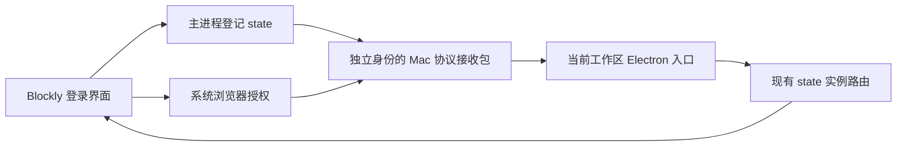
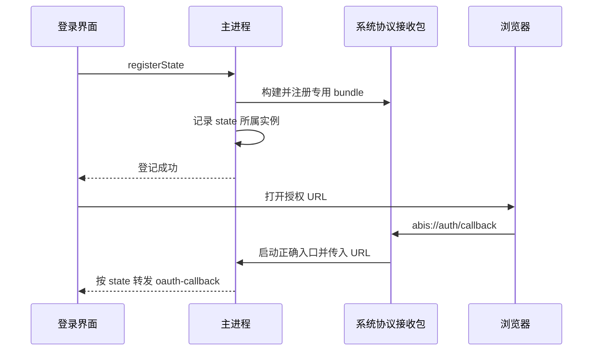

# Mac 开发登录回调修复计划

## Intent：最终目标

修复开发态切换区域后登录打开空白 Electron 窗口的问题，使回调进入发起登录的 Blockly 实例。

## Data：可用证据

- 已观察到系统将 `abis` 交给通用 `com.github.Electron`，错误窗口来自 Lex 内置浏览器的 Electron.app。
- Blockly 开发实例与另一份 Electron.app 共用 bundle ID，当前代码把 Windows 的 executable/args 注册方式也用于 macOS。
- [Electron 官方说明](https://www.electronjs.org/docs/latest/tutorial/launch-app-from-url-in-another-app)要求 macOS 协议处理通过声明协议的应用包注册。
- Blockly 已有 state 到实例的登记和回调文件转发；renderer 当前未等待登记完成便把授权 URL 交给调用方。

## Edges：边界与限制

- 仅为 macOS 开发态生成独立协议接收包，不修改依赖中的 Electron.app。
- Windows 与正式安装包保留现有注册路径；不修改 OAuth 服务端 redirect URI。
- 接收包只负责把 URL 作为参数传到当前工作区入口，不处理 token 和账号业务。
- 不使用浏览器进行 UI 检查，不自动完成真实账号授权，不增加测试用例。
- 原生接收程序使用 macOS 开发工具链编译，生成物放入用户缓存，不提交二进制。

## Answer：交付与成功标准

1. 独立原生协议接收程序及按需构建、注册模块。
2. 主进程在开发态登录登记前准备协议接收包；renderer 等待登记成功。
3. 检查原生编译、实际系统协议归属、现有产品身份测试与 Angular 构建。
4. 执行记录明确真实账号登录未验证的边界及自我复核结论。

## 自我复核

已完成代码修复与系统派发验证；完整真实账号登录仍待重启后验收。详见 [修复记录](./Mac开发登录回调修复记录.md)。修复系统协议身份冲突与登记竞态，不将区域切换本身误判为根因。
