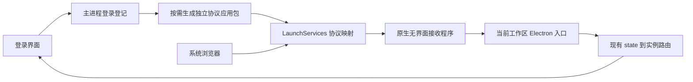
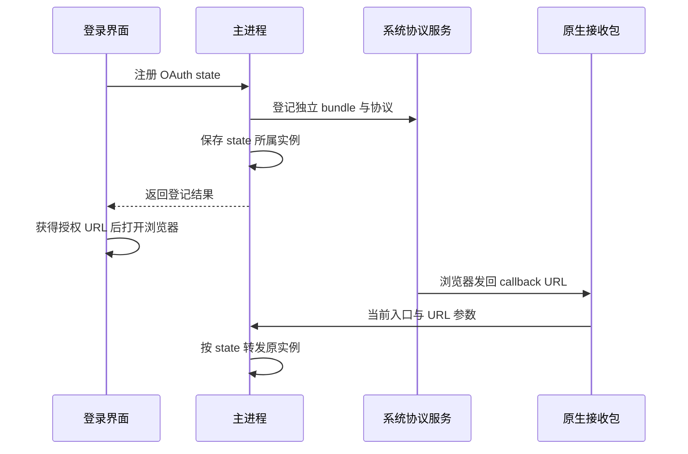

# Mac 开发登录回调修复记录

## Intent：最终目标

让开发态浏览器登录回调进入当前 Blockly 工作区，并由现有 state 路由送回发起登录的实例，消除通用 Electron 应用身份冲突。

## Data：实现与验证证据

### 实现

- `electron/native/macos-protocol-relay.m`：无界面原生 URL 接收程序，使用参数数组启动指定 Electron 与入口；不参与账号、token 或区域业务。
- `electron/macos-development-protocol.js`：按当前可执行文件、入口及产品参数生成唯一 bundle ID，声明协议并注册系统处理器；源码或配置变化时重新编译。
- `electron/main.js`：macOS 开发态不再注册通用 Electron；登录登记前按需准备专用接收包。Windows 与正式包保持现有注册分支。
- `auth.service.ts`：等待协议准备与 state 实例登记成功，再返回浏览器授权 URL。登记失败会进入既有错误处理流程。

### 验证结果

| 检查 | 结果与边界 |
| --- | --- |
| 原生编译 | 本机 arm64，使用系统 clang 编译成功 |
| 系统注册 | 接收程序注册后用 LaunchServices 查询并核对 `abis`、`ailyblockly` 的默认处理器，均为专用 bundle |
| 实际系统派发 | `/usr/bin/open -g` 发送不含 code/state 的 `error=access_denied` 回调；进程采样确认启动当前 Blockly Electron、`electron/main.js`、`--aily-build-product=blockly` 和 `--serve`，随后进程退出 |
| Info.plist | 系统 plutil 校验通过 |
| 产品身份 | 现有 `electron/build-product.test.js` 6/6 通过 |
| 前端构建 | `node scripts/run-angular.cjs build --configuration development` 通过；日志 `/tmp/aily-login-callback-build.log` |
| JavaScript 与差异 | 两个相关 JS 文件语法检查通过，`git diff --check` 通过 |

### 架构

### 数据流

## Edges：边界与限制

- 没有修改 aily-services，不依赖服务端更新。
- 没有自动完成真实账号登录，没有通过浏览器进行 UI 确认，也没有新增测试用例。
- 取消授权回调验证的是系统派发到正确入口，不等于验证了真实 code 交换、账号恢复和原窗口界面更新。
- 首次开发态登录需要 macOS Command Line Tools。正式包走已有协议声明，不依赖本接收程序。
- 运行中的旧主进程需要重启才会使用新增登记逻辑；使用现有 `./local.simulator.sh` 即可。
- 已存在的错误 Electron 窗口未自动关闭；它不属于这次验证启动的进程。

## Answer：交付结论与成功标准

代码修复、原生构建、系统协议归属和实际派发验证已完成。完整验收仍需重新启动 Blockly 后进行一次真实账号登录，确认回到原窗口且账号恢复。改动留在本地，未提交。

## 自我复核

- 区域切换是触发重新登录的操作；已确认的根因是 macOS 开发应用身份冲突，另有登记不等待的竞态。
- 独立接收包避免修改依赖内 Electron.app 的标识、签名和协议配置；仅承担 OS 到应用入口的转发。
- 当前方案没有重写已有多实例 OAuth 路由，也未声称解决其所有并发场景。
- 已移除补丁工具造成的无关空行扩张，现有文件只保留必要改动。
