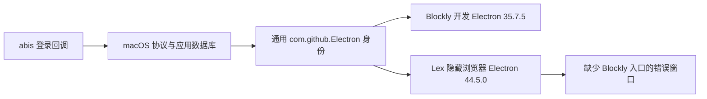
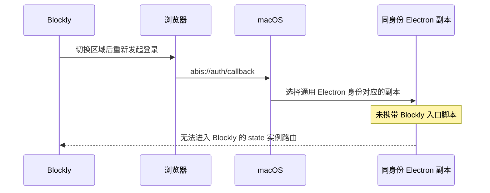

# 登录回调异常引入时间追溯

## Intent：最终目标

解释此前可以登录、此次却打开错误 Electron 窗口的原因，区分历史实现缺陷、冲突副本引入、系统登记和实际故障发生时间。

## Data：可用证据

所有时间均为 UTC+8。通过 Git 提交、行级历史、当前源码 AST、应用 Info.plist、文件元数据、LaunchServices 数据库与进程启动记录交叉核对。

| 时间 | 证据 | 能证明的事实 |
| --- | --- | --- |
| 2025-09-23 15:58 | Blockly `e63908def6d7eff3863b1646104a336392733836` | 加入 `app.setAsDefaultProtocolClient(PROTOCOL)`，没有区分 macOS 开发应用身份 |
| 2025-09-25 16:12 | Blockly `17eda4bc25641ab00f7d66564d0327d39f45b1b3`，提交说明“解决多实例下登录问题” | 加入 state 到实例登记，但 renderer 不等待登记 Promise 完成；这是独立竞态，并非证实的本次选错 Electron 原因 |
| 2025-11-20 15:15 | Blockly `5f93e9fa8b7adbadba7bf4f870c942f0e9937eae` | 开发态增加 executable 与入口参数，但未区分这两个参数在 Electron API 中仅适用于 Windows |
| 2026-09-07 00:43 | Blockly `aa575ee5ff7844dc5e513e317b1ff62a8c1f1afd` | 分离 Blockly/Coder 协议并加入别名，沿用原注册机制 |
| 2026-09-20 18:16 | Blockly `f8aa9152af1cb7d0de61fa0b0257e5e0b9ae9eec` | 补充产品与 serve 参数，没有引入通用 bundle ID 冲突这一机制 |
| 2026-09-30 11:27 | 本机 Lex 缓存 Electron.app 目录与 plist 元数据 | 此次错误进程对应的缓存副本在本机已生成；这是文件时间，不能替代系统登记时间 |
| 2026-09-30 15:37 | Lex `4fb4ace459fb1a3bf2f7f77ac52a2942f73f33ef` | 提交 `browser-runtime.ts`：复制 Electron.app、修改 LSUIElement、重新签名，保留原 CFBundleIdentifier |
| 2026-10-09 10:12 | LaunchServices 中该 Lex 副本的 reg date / rec mod date | 当前数据库记录该副本于此时登记为 `com.github.Electron` |
| 2026-10-14 13:22 | LaunchServices 中 Blockly 开发 Electron 的 reg date | Blockly 副本也登记为同一个 `com.github.Electron`，可确认两者同时存在于系统注册记录 |
| 2026-10-19 15:56:18 | 错误进程 PID 36842 的启动时间和命令行 | 启动的是 Lex 缓存 Electron.app，命令行没有 Blockly 入口脚本，是此次故障的直接运行证据 |

### 当前两个冲突应用

- Blockly：`aily-blockly/node_modules/electron/dist/Electron.app`，版本 35.7.5，bundle ID 为 `com.github.Electron`。
- Lex：`aily-lex-pro/packages/aily-elements/.local/browser-runtime/e49814f39d1e91cdee57a1a945dd23cd70d309f3c49fc125a252ffffc27d3b88/Electron.app`，版本 44.5.0，同一 bundle ID。
- 两者磁盘上的 Info.plist 均没有 `CFBundleURLTypes`。
- 修复前排查到 `abis` 默认处理器为通用 Electron 标识；修复后已改为专用 Blockly 开发接收包，因此不能拿修复后的默认映射冒充历史状态。
- Lex 浏览器模型和运行入口没有找到显式调用 `setAsDefaultProtocolClient`。证据支持应用身份冲突，不支持声称 Lex 主动注册或抢占了 `abis`。

### 关键源码与提交

- [Blockly 最早协议注册提交](https://github.com/ailyProject/aily-blockly/commit/e63908def6d7eff3863b1646104a336392733836)
- [Blockly 开发态参数注册提交](https://github.com/ailyProject/aily-blockly/commit/5f93e9fa8b7adbadba7bf4f870c942f0e9937eae)
- [Lex 浏览器缓存副本引入提交](https://github.com/ailyProject/aily-lex-pro/commit/4fb4ace459fb1a3bf2f7f77ac52a2942f73f33ef)
- [Electron app API](https://www.electronjs.org/docs/latest/api/app#appsetasdefaultprotocolclientprotocol-path-args)：executable/path 与 args 为 Windows 参数；macOS 依赖应用包协议声明。

## Edges：边界与限制

- 未取得用户最后一次成功登录的具体日期和当时运行的是安装版还是开发版，不能据此断言此前成功的唯一原因。
- LaunchServices 的登记时间不能证明默认 handler 恰好在同一时刻改变，也不是“首次失败”的时间戳。
- 没有完整历史路由日志，不能确定 macOS 每次如何在相同 bundle ID 的副本间选择；不能仅凭 Lex 版本更高就断言选择算法。
- 当前代码与已提供的 Blockly 基线 `090c6d1f6` 对比，原协议注册方式本就存在；此前本地仿真、生产授权接入改动没有修改该注册区域。最近一次 callback 专项修复才修改此处。
- 本轮仅追溯与记录，没有修改 Lex 或继续扩大业务代码修复范围。

## Answer：原因与时间结论

最合理且与已观察证据一致的解释是：Blockly 开发态长期依赖通用 Electron 身份接收协议，后来系统出现并登记了同身份的 Lex 浏览器副本，导致此次回调启动错误应用。区域切换触发重新登录，暴露了这个问题。

缺陷机制可追溯至 2025 年的 Blockly 协议注册；此次冲突副本来自 2026-09-30 的 Lex 提交，本机系统登记时间为 2026-10-09 10:12。能够直接确认的故障发生在 2026-10-19 15:56:18，无法确定更早的第一次失败时刻。

此前成功可以由系统当时路由到了正在运行的正确 Electron，或者当时使用独立身份的安装版解释；这些是合理可能性，并非已经恢复出的历史事实。

### 架构关系

### 故障数据流

## 自我复核

- 不把最近一次改动或单个 blame 结果直接当作回归提交；已向前查看实际补丁。
- 不把 state 登记竞态与本次系统启动错误 Electron 混为一个原因。
- 不将 9 月 30 日代码提交、10 月 9 日系统登记与 10 月 19 日已观察故障混为同一个“引入时间”。
- 对此前成功的解释明确标为可能性；对第一次失败时间保留不确定性。
