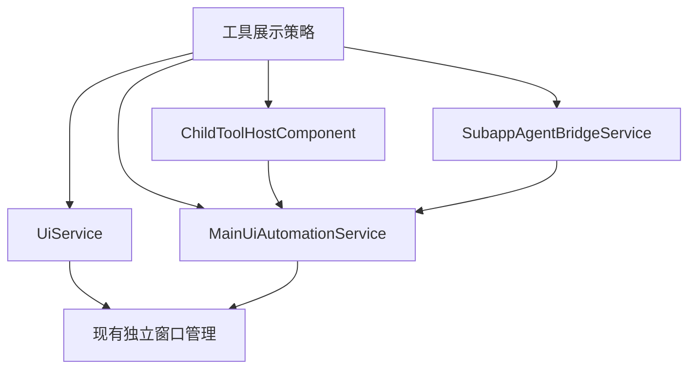
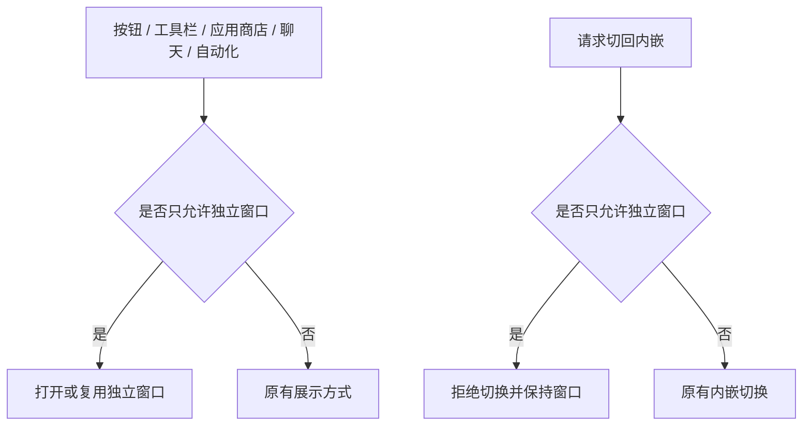

# 电路仿真独立窗口执行计划

## Intent：最终目标

aily-blockly 中电路仿真的可见界面始终使用独立窗口；工具栏、应用商店、自动化、聊天活动入口采用一致规则，禁止切回内嵌。

## Data：可用证据

- `DevToolComponent.showCircuit` 已传入 `mode: 'window'`，仅修改此按钮无法解决其他入口。
- `UiService.openTool` 在无法聚焦既有窗口时进入主窗口工具栈。
- `MainUiAutomationService.openChildApp` 默认使用 `embedded`，并支持 `embed` 控制。
- `ChildToolHostComponent` 提供 `go-main` 按钮和内嵌切换方法。
- Agent 的显式 `presentUi: 'embedded'` 会映射为聊天 Dock；聊天活动展开也可能创建内嵌界面。

## Edges：边界与限制

- 仅修改 aily-blockly；不修改仿真运行时、项目通信、安装逻辑及其他子应用的展示规则。
- 将 Simulator 只能独立展示作为宿主的集中式产品配置，不在各入口散落 Simulator ID 判断。
- 保留现有独立窗口创建、复用、生命周期及原生窗口按钮机制。
- 后台调用不应因窗口限制而自动打开界面。
- 不新增测试用例，不调用浏览器进行 UI 确认。

## Answer：交付格式与成功标准

1. 在工具配置中集中声明独立窗口约束。
2. 普通打开入口遵守约束；显式内嵌打开改为独立窗口；切回内嵌动作明确拒绝。
3. 隐藏受限工具的“放回主窗口”按钮，聊天界面请求也遵守约束。
4. 完成 TypeScript 检查、适用的现有检查及差异审查，记录验证限制与自我审查。

### 架构图

### 数据流图

